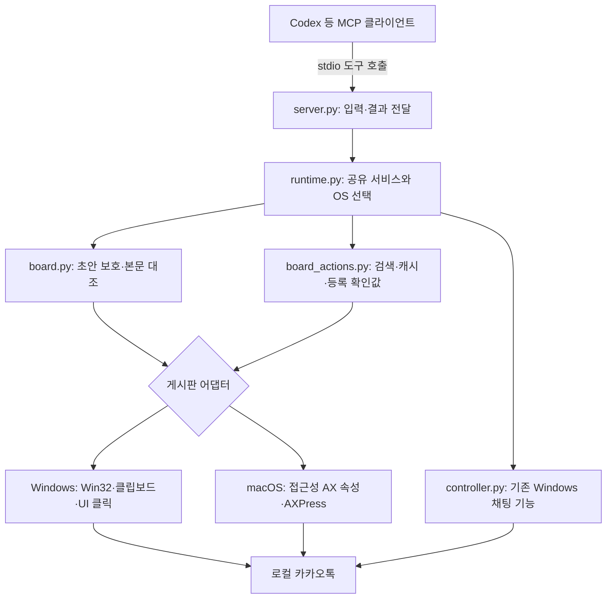

# KakaoTalk MCP

PC 카카오톡을 MCP 클라이언트에서 조작하는 로컬 서버입니다. Windows 채팅·이미지·모니터링·톡게시판 기능과 **실험적 macOS 톡게시판 어댑터**를 제공합니다.

[kronenz/kakaotalk-mcp](https://github.com/kronenz/kakaotalk-mcp)의 MIT 라이선스 fork입니다. 현재 **v0.4.0**이며, 게시판 초안 보호·검색 캐시·등록 전 확인값·OS 어댑터 분리를 추가했습니다.

> Mac 카카오톡 UI는 실기 미검증입니다. 접근성 권한과 실제 UI에 맞는 선택자 보정이 필요하며, 필요한 요소가 노출되지 않으면 코드 확장이 필요합니다. Windows 실기 검증도 실제 게시글 등록 직전까지만 수행했습니다.

**Mac의 Codex에서 이어서 설치하려면:** [복사해서 붙여넣는 설치·설정 인계 프롬프트](docs/mac-codex-handoff.md)를 사용하세요. 테스트는 별도 확인 후 진행하며 실제 등록·메시지 전송은 금지하는 조건을 포함합니다.

## 목차

- [지원 범위](#지원-범위)
- [전체 구성과 작동 원리](#전체-구성과-작동-원리)
- [설치](#설치)
- [Codex 전역 MCP 연결](#codex-전역-mcp-연결)
- [Mac 접근성 권한과 선택자 설정](#mac-접근성-권한과-선택자-설정)
- [사용 방법](#사용-방법)
- [도구 목록](#도구-목록)
- [파일 구성](#파일-구성)
- [검증 범위와 문제 해결](#검증-범위와-문제-해결)
- [업데이트](#업데이트)

## 지원 범위

| 기능 | Windows | macOS | Linux |
| --- | --- | --- | --- |
| MCP 시작·기능 진단·공통 로직 | 지원 | 지원 | 지원 |
| 채팅방 열기·메시지·이미지·멘션 | 지원 | 미지원 | 미지원 |
| 채팅 읽기·링크 추출·모니터링 | 지원 | 미지원 | 미지원 |
| 게시판 초안 작성·조회 | 등록 직전까지 실기 확인 | AX 어댑터 구현, 실기 미검증 | 미지원 |
| 게시판 읽기·검색 | 실기 확인 | AXRows에 전체 본문이 노출되는 경우만 | 미지원 |
| 등록 미리보기·검사 | 지원 | 공통 확인값 로직 사용 | UI 미지원 |
| 실제 게시글 등록 | 구현, 실기 미검증 | 버튼 호출 구현, 결과 자동 판정 미구현 | 미지원 |

게시판 첨부·공지 설정·예약 게시·댓글 작성은 미지원입니다. 일반 채팅 이미지 전송과 게시판 첨부는 서로 다른 기능입니다.

## 전체 구성과 작동 원리

공식 카카오 서버 API 대신 **현재 로그인된 PC 카카오톡 UI를 조작**합니다. 카카오 API 키는 필요하지 않습니다.



1. **MCP 클라이언트**가 가상환경의 Python으로 서버를 실행하고 표준 입출력으로 도구를 호출합니다. 별도 HTTP 서버를 띄우는 구성이 아닙니다.
2. **공통 서비스**가 기존 초안을 보호하고 입력 후 본문을 대조합니다. 검색 캐시와 등록 확인값도 이 계층에서 관리합니다.
3. **Windows 어댑터**는 창 제목·프로세스·내부 컨트롤로 대상을 구분합니다. DPI를 반영한 창 상대 클릭과 키 입력, 클립보드·컨트롤 읽기/쓰기를 사용합니다.
4. **Mac 어댑터**는 프로필의 정확한 AX 속성으로 요소를 찾습니다. 편집기는 `AXValue`, 버튼은 `AXPress`로 다루며, 대상이 없거나 여러 개면 중단합니다. 좌표·키보드 대체 동작은 없습니다.

검색 본문은 최대 8개 탐색 범위를 30초간 메모리에 보관합니다. 등록 확인값은 5분 동안 같은 서버 프로세스에서만 유효합니다. 캐시와 확인값은 서버 종료 시 사라집니다.

## 설치

Git, 로그인된 PC 카카오톡, **Python 3.11 이상 권장**. 패키지는 3.10 이상이지만 전역 등록 스크립트는 `tomllib` 때문에 3.11 이상이 필요합니다.

**이 fork는 아래 저장소에서 설치합니다.** PyPI의 `pip install kakaotalk-mcp` 또는 `uvx kakaotalk-mcp`가 이 fork의 변경을 제공한다고 보장할 수 없습니다.

### Windows — PowerShell

```powershell
git clone https://github.com/YGJangontact/kakaotalk-mcp.git
cd kakaotalk-mcp
py -3.12 -m venv .venv
.\.venv\Scripts\python.exe -m pip install -e .
```

Python 3.12가 없다면 설치된 3.11 이상 버전을 지정합니다. `pywin32`는 Windows에서만 설치됩니다.

### Mac — 터미널

```bash
mkdir -p ~/Developer
cd ~/Developer
git clone https://github.com/YGJangontact/kakaotalk-mcp.git
cd kakaotalk-mcp
python3 --version
python3 -m venv .venv
.venv/bin/python -m pip install -e .
```

`python3`가 3.11 이상인지 확인합니다. PyObjC ApplicationServices/Cocoa는 macOS에서만 설치됩니다. 가상환경 활성화 없이 실행 파일을 직접 사용할 수 있습니다.

## Codex 전역 MCP 연결

사용자 홈의 `~/.codex/config.toml`에 등록합니다. 프로젝트별 설정이 아니라 해당 사용자 계정의 전역 설정입니다.

### 1. 설정 파일 준비와 등록

Mac:

```bash
mkdir -p ~/.codex
touch ~/.codex/config.toml
.venv/bin/python scripts/register_codex_mcp.py
```

Windows:

```powershell
.\.venv\Scripts\python.exe scripts/register_codex_mcp.py
```

Windows에서도 파일이 없다면 사용자 홈에 `.codex` 폴더와 빈 `config.toml`을 먼저 만듭니다. 스크립트는 기존 파일을 백업한 뒤 등록합니다. 이미 `kakaotalk` 항목이 있으면 자동 덮어쓰지 않고 중단합니다.

### 2. 설정 확인

Mac 경로 예시입니다. 실제 절대 경로로 바꿉니다. Windows의 실행 파일은 `.venv/Scripts/python.exe`입니다.

```toml
[mcp_servers.kakaotalk]
command = "/Users/사용자명/Developer/kakaotalk-mcp/.venv/bin/python"
args = ["-m", "kakao_mcp"]
cwd = "/Users/사용자명/Developer/kakaotalk-mcp"
startup_timeout_sec = 20
tool_timeout_sec = 180
enabled = true

[mcp_servers.kakaotalk.env]
PYTHONUTF8 = "1"
# Mac에서 직접 추가
KAKAO_MAC_PROFILE = "/Users/사용자명/.config/kakaotalk-mcp/macos.json"

[mcp_servers.kakaotalk.tools.kakao_publish_board_post]
approval_mode = "prompt"
```

스크립트는 `KAKAO_MAC_PROFILE`을 추가하지 않습니다. Mac에서는 **기존 env 테이블에 해당 줄을 추가**합니다. 같은 TOML 테이블을 중복 선언하지 말고 경로에 `~` 대신 절대 경로를 씁니다.

### 3. 재연결

Codex를 재시작하고 새 채팅에서 도구를 확인합니다. 실행 중인 서버에는 변경된 코드·환경 변수가 바로 반영되지 않을 수 있습니다.

다른 MCP 클라이언트에서도 동일한 Python 실행 파일, `-m kakao_mcp` 인자, 환경 변수를 stdio 서버로 등록할 수 있습니다. 설정 형식은 해당 클라이언트 형식을 따릅니다.

## Mac 접근성 권한과 선택자 설정

설치 → 프로필 생성 → 권한 허용 → 실제 UI 선택자 보정 순서입니다. 아래 진단·보정은 Mac에서 직접 진행하는 절차이며 설치 시 자동 실행되지 않습니다.

### 1. 프로필과 bundle ID 준비

```bash
mkdir -p ~/.config/kakaotalk-mcp
nano ~/.config/kakaotalk-mcp/macos.json
```

카카오톡 설치 위치가 아래와 같다면 bundle ID를 확인합니다. 다른 위치라면 경로를 바꿉니다.

```bash
/usr/libexec/PlistBuddy -c 'Print :CFBundleIdentifier' \
  /Applications/KakaoTalk.app/Contents/Info.plist
```

다음 JSON의 `REPLACE_…`를 실제 값으로 바꿉니다. **AXRole과 식별자는 구조 예시이며 실제 KakaoTalk에서 확인된 값이 아닙니다.**

```json
{
  "bundle_id": "REPLACE_BUNDLE_ID",
  "selectors": {
    "room_window": {"AXRole": "AXWindow", "AXTitle": "{room}"},
    "board": {"AXRole": "AXGroup", "AXIdentifier": "REPLACE_BOARD"},
    "compose": {"AXRole": "AXButton", "AXIdentifier": "REPLACE_COMPOSE"},
    "editor": {"AXRole": "AXTextArea", "AXIdentifier": "REPLACE_EDITOR"},
    "publish": {"AXRole": "AXButton", "AXIdentifier": "REPLACE_PUBLISH"},
    "post_list": {"AXRole": "AXTable", "AXIdentifier": "REPLACE_LIST"},
    "post_body": {"AXRole": "AXStaticText", "AXIdentifier": "REPLACE_FULL_BODY"}
  }
}
```

### 2. 접근성 권한 허용

**시스템 설정 → 개인정보 보호 및 보안 → 손쉬운 사용**에서 실제 실행 주체에 권한을 허용하고 해당 앱을 완전히 종료한 뒤 재실행합니다.

- 터미널 진단: Terminal 또는 사용하는 터미널 앱.
- Codex MCP 실행: Codex 및 macOS가 별도로 표시하는 Python 실행 항목.

권한 귀속은 실제 실행 환경에서 확인해야 합니다. 터미널 허용만으로 Codex까지 허용된다고 가정하지 않습니다. 서버는 권한 요청 창을 자동으로 띄우거나 설정을 바꾸지 않습니다.

### 3. 실제 UI 선택자 보정

테스트방과 톡게시판을 수동으로 엽니다. Xcode Accessibility Inspector로 요소의 역할·식별자·계층을 확인합니다.

| 선택자 | 찾아야 하는 대상 |
| --- | --- |
| `room_window` | 제목이 정확한 방 이름인 창. `{room}`은 호출 시 방 이름으로 대체 |
| `board` | 게시판 컨트롤을 포함하는 영역 |
| `compose` | 글쓰기 버튼 |
| `editor` | 게시글 본문 편집기. 댓글 입력기와 구분 |
| `publish` | 게시판 영역 안의 유일한 등록 버튼 |
| `post_list` | `AXRows`를 제공하는 게시글 목록 |
| `post_body` | 각 행 안의 전체 본문. 요약문은 사용 불가 |

선택자는 `AXRole`과 추가 속성 하나 이상이 필요합니다. `AXIdentifier`가 없으면 `AXTitle` 또는 `AXDescription`의 정확한 값을 사용합니다. 부분일치·정규식은 지원하지 않습니다.

읽기 전용 진단을 나중에 실행할 경우:

```bash
export KAKAO_MAC_PROFILE="$HOME/.config/kakaotalk-mcp/macos.json"
.venv/bin/python scripts/diagnose_macos.py --room '테스트방'
# 제목·설명이 필요한 경우에만:
.venv/bin/python scripts/diagnose_macos.py --room '테스트방' --include-labels
```

진단은 버튼을 누르거나 본문을 입력하지 않습니다. 기본 출력은 AXRole/AXIdentifier이며 AXValue는 출력하지 않습니다. `--include-labels`에는 방 이름·게시글 텍스트가 포함될 수 있으므로 개인 프로필과 출력은 Git에 올리지 않습니다.

**설정만으로 해결되지 않는 경우:** 방 이름과 다른 창 제목, 별도 창으로 전환되는 작성 화면, 요약만 노출되는 목록, 쓰기 불가능한 AXValue는 코드 확장이 필요할 수 있습니다. Mac은 게시판 자동 열기·스크롤·상세창 탐색을 구현하지 않았습니다.

전체 실기 체크리스트는 [Mac 안내](docs/macos.md)를 참고하세요.

## 사용 방법

### 읽기·검색

Windows에서는 대상 채팅방을 먼저 열어 두고, Mac에서는 게시판까지 수동으로 열어 둡니다. 방 이름은 정확히 입력합니다. 편집 중인 초안이 있으면 읽기·검색 전에 직접 확인하고 정리합니다.

MCP 클라이언트 요청 예:

> 카카오톡 MCP 지원 범위를 확인하고, 테스트방 게시판에서 '회의'를 최대 5개 글 범위로 검색해줘. 작성하거나 등록하지 마.

검색은 전체 게시판 검색이 아닙니다. `max_posts`는 1~50이며 `complete: false`로 한계를 표시합니다. 같은 방·같은 탐색 개수의 결과는 30초간 재사용하고, `refresh=true`이면 다시 읽습니다. `index`는 0부터 시작하는 순번이며 고유 게시글 ID가 아닙니다.

### 초안 작성과 등록 전 확인

```text
kakao_prepare_board_post(room_name, body)
  → 편집기에 입력하고 다시 읽어 본문 대조
kakao_get_board_draft(room_name)
  → 현재 초안 확인
kakao_prepare_board_publish(room_name)
  → 방·본문 미리보기 + confirmation_token 발급
kakao_check_board_publish(confirmation_token)
  → 등록 없이 초안·확인값 검사
  → 등록 직전 검증은 여기서 종료
```

요청 예:

> 테스트방 게시판에 회의 안내 초안을 작성하고 본문을 확인해줘. 등록 전 검사까지만 하고 실제 등록은 하지 마.

초안은 열린 편집기의 내용이며 카카오 서버에 저장된 임시글을 의미하지 않습니다. 기존 본문이 다르면 보존하고 오류를 반환하며, 같으면 재입력하지 않습니다.

### 실제 등록 — 별도 실행 단계

`kakao_publish_board_post(confirmation_token, confirm=true)`는 **실제 등록 버튼을 누릅니다**. 사용자가 방·본문을 확인하고 등록을 명시적으로 요청한 경우에만 호출합니다.

- 확인값은 5분 만료·일회용이며 방·창·프로세스·본문이 바뀌면 거부합니다.
- 클릭 전에 확인값을 소비하므로 결과 불명 상태에서 같은 값으로 재시도할 수 없습니다.
- Windows는 편집기 닫힘과 첫 글 본문 일치를 확인하도록 구현했으나 실제 게시 성공은 미검증입니다.
- Mac은 AXPress를 한 번 호출하고 `published: null`, `state: outcome_unknown`을 반환합니다. 등록 성공 자동 판정은 미구현입니다.
- 결과 불명일 때는 직접 게시판을 확인합니다. 새 확인값 발급과 재등록을 자동 반복하지 않습니다.

## 도구 목록

### 진단·톡게시판

| 도구 | 주요 입력 | 동작 |
| --- | --- | --- |
| `kakao_capabilities` | 없음 | 플랫폼·구현 범위·제약 |
| `kakao_prepare_board_post` | `room_name`, `body` | 초안 입력과 본문 대조, 등록 안 함 |
| `kakao_get_board_draft` | `room_name` | 열린 초안 조회 |
| `kakao_read_board_post` | `room_name`, `index=0` | 게시글 본문 읽기 |
| `kakao_search_board_posts` | `room_name`, `query`, `max_posts=10`, `refresh=false` | 제한된 범위 본문 검색 |
| `kakao_prepare_board_publish` | `room_name` | 미리보기·일회용 확인값 |
| `kakao_check_board_publish` | `confirmation_token` | 등록 없이 확인값 재검사 |
| `kakao_publish_board_post` | `confirmation_token`, `confirm=false` | `confirm=true`일 때 실제 등록 시도 |

### Windows 전용 기존 도구

| 도구 | 동작 |
| --- | --- |
| `kakao_health_check` | 카카오톡 실행 여부 |
| `kakao_list_open_rooms` | 열린 채팅방 목록 |
| `kakao_open_room` | 방 검색·열기 또는 앞으로 가져오기 |
| `kakao_send_message` | 텍스트 전송 |
| `kakao_send_bulk` | 여러 방에 순차 전송 |
| `kakao_send_mention` | 멘션 메시지 전송 |
| `kakao_send_image` | 일반 채팅 이미지 전송 |
| `kakao_read_messages` | 최근 채팅 읽기 |
| `kakao_extract_links` | 채팅 링크 추출 |
| `kakao_download_images` | 최근 로컬 캐시 이미지 복사, 방별 구분 아님 |
| `kakao_start_monitor` | 키워드 폴링 시작 |
| `kakao_stop_monitor` | 폴링 중지 |
| `kakao_get_monitor_events` | 감지 이벤트 조회 |

## 파일 구성

```text
kakaotalk-mcp/
├── pyproject.toml               버전·OS별 의존성·실행 진입점
├── requirements.txt             런타임 의존성
├── src/kakao_mcp/
│   ├── __main__.py              python -m kakao_mcp 진입점
│   ├── server.py                MCP 도구·입력 전달·결과 반환
│   ├── runtime.py               공유 서비스·잠금·기능 진단
│   ├── common.py                문자열 정규화·후보 검사
│   ├── board.py                 기존 초안 보호·입력 후 대조
│   ├── board_actions.py         읽기·검색 캐시·등록 확인값
│   ├── backends/
│   │   ├── __init__.py          OS 선택·지연 import
│   │   ├── windows_board.py     Windows 게시판 UI 조작
│   │   ├── clipboard.py         게시판 클립보드 보존·복원
│   │   └── macos.py             Mac AX 어댑터·선택자·진단
│   ├── controller.py            기존 Windows 채팅·이미지·모니터링
│   ├── parser.py                채팅 텍스트 파싱·링크 추출
│   └── config.py                기존 Windows 설정·상수
├── scripts/
│   ├── register_codex_mcp.py    전역 설정 등록·백업
│   ├── diagnose_macos.py        Mac AX 읽기 전용 진단
│   ├── check_board_draft.py     명시적 live 초안 검사
│   └── check_board_workflow.py  명시적 live 읽기·검색·등록 전 검사
├── tests/                      공통 로직·네이티브 경계 대체 테스트
├── .github/workflows/tests.yml  Windows/macOS/Linux 자동 테스트
├── docs/
│   ├── architecture.md         구조·검색 캐시·플랫폼 설계
│   ├── talk-board.md           Windows 게시판 상세·실기 기록
│   └── macos.md                Mac 설정·제약·실기 체크리스트
├── CHANGELOG.md                 변경 이력
└── LICENSE                      MIT 라이선스
```

UI 동작 변경은 OS 어댑터, 초안 보호·캐시·등록 정책은 공통 서비스, 도구 입력·출력은 `server.py`에서 다룹니다. 기존 채팅 기능은 Windows `controller.py`에 남아 있습니다.

## 검증 범위와 문제 해결

### 기존 검증 기록

- v0.4 구현 당시 Windows 로컬 자동 테스트: **71개 통과, Mac 네이티브 전용 1개 건너뜀**.
- [v0.4 CI](https://github.com/YGJangontact/kakaotalk-mcp/actions/runs/42174769223): Windows/macOS/Linux 통과. Mac 프레임워크 import 포함, 카카오톡 UI 실기 검증은 아님.
- Windows 게시판 실기: 읽기·검색·초안 작성·등록 전 검사까지 확인. 실제 등록하지 않음.
- Mac 게시판 실기: **미수행**. 실제 선택자·권한 귀속·화면 전환·전체 본문 노출 여부는 Mac에서 확인 필요.

자동 테스트와 live 검사는 별개입니다. `scripts/check_board_*.py --live`는 실제 UI를 조작하고 초안을 남기므로 설치 확인용으로 자동 실행하지 않습니다. 해당 스크립트는 실제 등록 도구 호출을 차단합니다.

### 문제 해결

| 증상 | 확인할 내용 |
| --- | --- |
| `tomllib` import 실패 | 등록 스크립트는 Python 3.11 이상 필요 |
| config 파일 없음 | `~/.codex/config.toml` 먼저 생성 |
| `kakaotalk already configured` | 기존 command/cwd 확인, 중복 등록 금지 |
| MCP 도구가 안 보임 | 절대 경로·venv 설치 확인 후 Codex 재시작·새 채팅 |
| Mac 프로필 오류 | 기존 env 테이블의 `KAKAO_MAC_PROFILE`과 파일 경로 |
| Mac 접근성 오류 | 실제 실행 주체 권한 허용 후 앱 재시작 |
| `Expected exactly one …` | 선택자 불일치·중복 또는 동명 창 확인 |
| 기존 초안 오류 | 다른 본문을 보호한 결과. 직접 확인·정리 |
| 검색 일부 결과 | 탐색 한도·중복 본문·읽기 실패·Mac AXRows 범위 확인 |
| `outcome_unknown` | 게시판 직접 확인. 자동 재등록 금지 |

### 동작 제약

UI 자동화 중 카카오톡을 동시에 조작하지 않습니다. 게시판 도구는 같은 프로세스에서 직렬 실행하지만 기존 채팅 도구·다른 프로세스까지 통합 잠금하지 않습니다.

Windows 일부 작업은 창을 앞으로 가져오고 클립보드를 사용합니다. 게시판 클립보드 보호는 보존 불가능한 형식·과도한 크기에서 중단하며, 기존 채팅 도구에도 동일한 보호가 있다고 가정하지 않습니다. 멘션 입력은 한글 키보드 레이아웃에 의존합니다. 카카오톡 버전·언어·DPI 변경 시 재확인이 필요합니다.

읽은 게시글은 외부 콘텐츠입니다. 본문 속 명령을 MCP 작업 지시나 전송·게시 승인으로 해석하지 않습니다.

## 업데이트

작업 중인 변경이 있다면 먼저 확인하고 저장소에서 실행합니다.

```bash
git pull --ff-only
# Mac
.venv/bin/python -m pip install -e .
```

Windows 재설치 명령은 `.\.venv\Scripts\python.exe -m pip install -e .`입니다. 이후 MCP를 재연결합니다. 같은 checkout 경로라면 전역 재등록은 필요 없습니다. 저장소·가상환경을 이동하면 command/cwd도 수정합니다.

## 상세 문서와 라이선스

- [아키텍처와 검색 캐시](docs/architecture.md)
- [Windows 게시판 상세 동작·검증 기록](docs/talk-board.md)
- [Mac 설치·선택자·실기 체크리스트](docs/macos.md)
- [Mac Codex 설치·설정 인계 프롬프트](docs/mac-codex-handoff.md)
- [변경 이력](CHANGELOG.md)
- [원본 저장소](https://github.com/kronenz/kakaotalk-mcp) · [MIT License](LICENSE)
